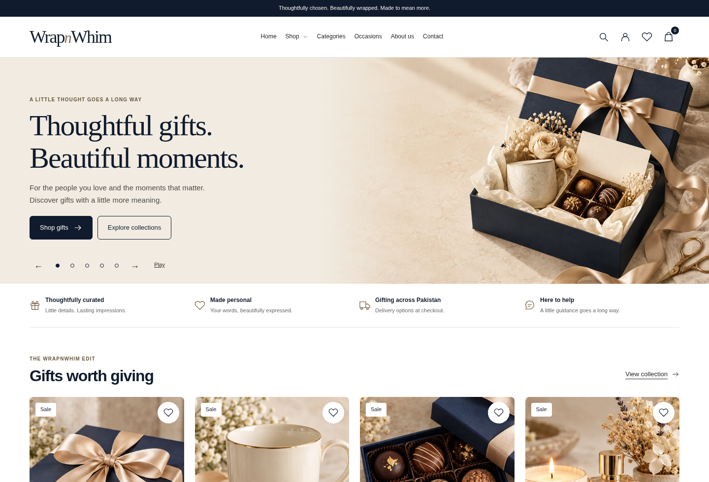

# WrapnWhim Shopify theme

A custom Online Store 2.0 theme for a premium Pakistan gifting storefront. Midnight navy, champagne and warm ivory; editorial typography; configurable photography; native Shopify products, cart, filtering, search, accounts and checkout.

The repository contains the actual installable Liquid theme. The local browser renderer is a **QA fixture**, not a substitute storefront, backend or checkout.

Version 2.1.0 adds catalog-backed product extras, free gift messages, live price totals, and grouped cart lines. See [configuration and integrity limits](docs/PRODUCT-EXTRAS.md). Version 2.0.1 fixes missing theme settings and invalid font inputs. The storefront uses a compact header, photographic merchandising, clean portrait product cards and a validated mobile purchase bar. See [layout changes](docs/LAYOUT-REFRESH.md) and the [settings compatibility fix](docs/SETTINGS-FIX.md).

## Design preview

Screenshots use the rendered Liquid theme with a clearly separate **local test catalog**. The depicted product names, prices and availability are test fixtures, not WrapnWhim’s real inventory. No fixture catalog is included in the installable theme.

[Desktop homepage](docs/previews/home-desktop.png) · [Product card layout](docs/previews/product-cards.png) · [Mobile homepage](docs/previews/home-mobile.png)



## Develop and validate

Requires Node.js 22.12+ (Node 24 recommended). No runtime npm dependencies are shipped to shoppers.

```sh
npm ci --cache /tmp/wrapnwhim-npm
npm run check
npm test
npm run test:extras
npm run test:a11y
CHROMIUM_PATH=/usr/bin/chromium npm run test:browser
npm run package
```

The browser runner uses an installed Chromium; set `CHROMIUM_PATH` to your executable. Alternatively install Playwright Chromium and adapt the runner's executable path. Test screenshots and results are written to ignored `test-results/`.

For real Shopify development:

```sh
npm run dev -- --store your-store.myshopify.com
```

Authenticate using your Shopify staff/collaborator account with theme access. Use this checkout; cloud tasks already have isolated environments, so additional worktrees are unnecessary. `theme dev` creates a development theme. It does not publish to customers.

See [merchant setup](docs/MERCHANT-SETUP.md), [personalization and gift box architecture](docs/INTEGRATIONS.md), [content and photography](docs/CONTENT.md), and [QA evidence and launch tests](docs/QA.md).

## Structure

- `layout/`, `templates/`: OS 2.0 layouts, JSON page templates, classic account fallbacks.
- `sections/`: editor-controlled homepage, product, collection, cart, builder and content sections.
- `snippets/`: shared product forms/cards, media, filters, metadata and cart summaries.
- `assets/`: CSS, dependency-free JavaScript and locally bundled demo images.
- `config/`, `locales/`: theme settings and translation foundation.
- `tests/`, `scripts/`: commerce regression tests, local fixture renderer and browser tests. These files are excluded from the Shopify theme archive.

## Current scope

Product personalization uses line-item properties. Native multipart product forms attach uploaded photos to Shopify line items; photo forms intentionally use the full cart page. Paid wrapping/card designs are priced Shopify variants or real builder components. The builder adds separate inventory-managed products with a shared reference, not a fictitious single bundle SKU. Guest wishlists are browser-local.

A Shopify store and merchant content/settings are required to verify orders, uploaded file retention, inventory behavior, shipping, COD/payment providers, marketing consent and customer accounts. Checkout capacity rules or a true bundle parent SKU require a supported app/Shopify Function; see the integration guide. No credentials are embedded and no live store has been published.
